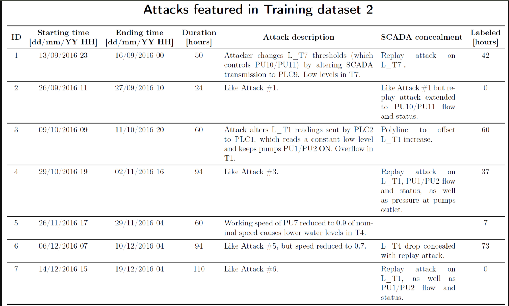

# Data audit: BATADAL files

## 1. Purpose and files

This audit checks the three BATADAL files before any models are built. The goal is to find problems in the data early (names, types, time order, empty cells, odd values, labels) and list the decisions the team needs to make.

All checks are in `notebooks/Data Audit.ipynb`. Every number below comes from the output of that notebook, except the real attack times, which come from the BATADAL site's attack table (saved as `docs/attacks_dataset2.png`). Nothing in the data files was changed.

| Name in this audit | File (in `data/`) | Role | Rows | Columns |
|---|---|---|---|---|
| Dataset 1 | `Training dataset 1.csv` | Normal training data (no attacks) | 8,761 | 45 |
| Dataset 2 | `Training dataset 2.csv` | Development data (partly labeled) | 4,177 | 45 |
| Test set | `BATADAL_test_dataset.csv` | Final test data (no labels) | 2,089 | 44 |

## 2. Summary table

| Check | Dataset 1 | Dataset 2 | Test set |
|---|---|---|---|
| Rows | 8,761 | 4,177 | 2,089 |
| Columns | 45: DATETIME, 43 features, ATT_FLAG | 45: DATETIME, 43 features, ATT_FLAG | 44: DATETIME, 43 features, no ATT_FLAG |
| Column names | OK | Leading space on every name except DATETIME. Fixed with `.strip()` | OK |
| Data types | DATETIME text, rest numeric | DATETIME text, rest numeric. All 43 features are float | DATETIME text, rest numeric |
| Decimal places (max) | 9 | 2 | 2 |
| On/off columns only 0 and 1 | Yes | Yes | Yes |
| Time order | Hourly, in order, no repeats, no gaps | Hourly, in order, no repeats, no gaps | Hourly, in order, no repeats, no gaps |
| Time range | 2014-01-06 00:00 to 2015-01-06 00:00 | 2016-07-04 00:00 to 2016-12-25 00:00 | 2017-01-04 00:00 to 2017-04-01 00:00 |
| Empty cells | 0 | 0 | 0 |
| Features that never change | 7 | 7 (same 7) | 6 (a different set) |
| L_T6 stops at 5.5 | Yes | Yes | Yes |
| Negative values | None | 1 (F_PU7 = -0.88) | None |
| Labels | All 0 | 3,958 × -999, 219 × 1, no 0 | No label column |

## 3. Findings

### Rows and columns

- Rows: Dataset 1 = 8,761, Dataset 2 = 4,177, Test set = 2,089.
- Dataset 1 and Dataset 2 have 45 columns: DATETIME, 43 features, and ATT_FLAG. The Test set has 44 columns, because it has no ATT_FLAG.
- The 43 features are 31 continuous and 12 on/off:
  - Continuous: L_T1 to L_T7 (tank levels), 12 F_ columns (flows: F_PU1 to F_PU11 and F_V2), and 12 P_ columns (pressures).
  - On/off: S_PU1 to S_PU11 and S_V2 (pump and valve status).

### Column names

- The Dataset 2 header has a space after each comma. Because of this, every column name except DATETIME had a leading space (for example `' L_T1'`).
- The spaces were removed with `.strip()` in the notebook. After that, all three files have the same feature columns in the same order. The only extra column in Dataset 1 and Dataset 2 is ATT_FLAG.

### Data types

- DATETIME is text in all three files. All other columns are numeric.
- Dataset 2 writes whole numbers as `1.00` and `0.00`, while Dataset 1 writes them as `1` and `0`. So pandas reads some columns as float in Dataset 2 and as int in Dataset 1. The values are the same. All values in these columns are whole numbers, and none are empty.
- Columns where the types differ:
  - Dataset 1 vs Dataset 2: 15 columns (all 12 S_ columns plus F_PU3, F_PU5, F_PU9).
  - Dataset 1 vs Test set: 2 columns. F_PU3 is int in Dataset 1 and float in the Test set. F_PU11 is float in Dataset 1 and int in the Test set. This matches the values: F_PU3 is always 0 in Dataset 1 but has real values in the Test set, and F_PU11 is the other way around.
  - Dataset 2 vs Test set: 15 columns (all 12 S_ columns plus F_PU5, F_PU9, F_PU11).

### Number precision

- Dataset 1 values have up to 9 decimal places. Dataset 2 and Test set values have at most 2.

### On/off columns

- All 12 S_ columns contain only 0 and 1 in all three files.

### Time

- DATETIME is day/month/year hour (for example `06/01/14 00` is 6 January 2014, 00:00).
- All three files are hourly, in order, with no repeated hours and no missing hours.
- Dataset 1: 2014-01-06 00:00 to 2015-01-06 00:00. Dataset 2: 2016-07-04 00:00 to 2016-12-25 00:00. Test set: 2017-01-04 00:00 to 2017-04-01 00:00.

### Empty cells

- There are no empty cells in any of the three files.

### Value ranges and sensors that never change

- Dataset 1 and Dataset 2: the same 7 features never change. S_PU1 is always 1. F_PU3, S_PU3, F_PU5, S_PU5, F_PU9, and S_PU9 are always 0. So pump 1 is always on, and pumps 3, 5, and 9 are always off.
- F_PU6, S_PU6, F_PU11, and S_PU11 are almost always 0 in Dataset 1 and Dataset 2. From the mean of the status columns, pump 6 is on for 16 hours in Dataset 1 and 87 hours in Dataset 2. Pump 11 is on for 4 hours in Dataset 1 and 32 hours in Dataset 2.
- L_T6 stops at 5.5 in all three files. The median, 75th percentile, and max are all 5.5. It looks like an upper limit on that tank. It was not treated as an error.
- Dataset 2 has one negative flow: F_PU7 = -0.88 at 2016-12-08 01:00. Pump 7's status (S_PU7) is 1 on that row. On the rows around it, the flow is 0 or near 0 (0.00, 0.00, -0.88, 0.43, 0.00) and the pump switches on and off. The row is inside a labeled attack. The value was left as is.
- Test set: F_PU5, S_PU5, F_PU9, S_PU9, F_PU11, and S_PU11 are always 0. Unlike in the training files, F_PU3 and S_PU3 are not constant (F_PU3 reaches 119.56), and S_PU1 is 0 in a few rows (about 10, from the mean of 0.995). A few sensors go above the training max:

  | Sensor | Max in Dataset 1 | Max in Dataset 2 | Max in Test set |
  |---|---|---|---|
  | L_T1 | 4.87 | 5.73 | 6.34 |
  | P_J415 | 105.95 | 107.95 | 122.93 |

### Labels (ATT_FLAG)

- Dataset 1: all 8,761 rows are 0. This matches the BATADAL site, which says Dataset 1 has no attacks.
- Dataset 2: 3,958 rows are -999 (unlabeled) and 219 rows are 1 (attack). No rows are 0, so no row is labeled as confirmed normal.
- The Test set has no label column.

### Attack periods in Dataset 2

The notebook finds 5 runs of back-to-back hours labeled 1. These runs add up to 219 hours, which is every row labeled 1. The BATADAL site lists 7 attacks for Dataset 2. The full table from the site is below, with the labeled runs from the notebook added on the right. Start and end times are written as YYYY-MM-DD HH:MM.

| ID | Real start | Real end | Real hours | Attack (from the site) | SCADA concealment (from the site) | Labeled hours (site) | Labeled run in the notebook | Labeled hours (notebook) | Hours from real start to labeled start |
|---|---|---|---|---|---|---|---|---|---|
| 1 | 2016-09-13 23:00 | 2016-09-16 00:00 | 50 | Attacker changes L_T7 thresholds (which control PU10/PU11) by altering SCADA transmission to PLC9. Low levels in T7. | Replay attack on L_T7. | 42 | 2016-09-14 03:00 to 2016-09-15 20:00 | 42 | 4 |
| 2 | 2016-09-26 11:00 | 2016-09-27 10:00 | 24 | Like attack 1. | Like attack 1, but the replay attack is extended to PU10/PU11 flow and status. | 0 | none | 0 | not labeled |
| 3 | 2016-10-09 09:00 | 2016-10-11 20:00 | 60 | Attack alters L_T1 readings sent by PLC2 to PLC1, which reads a constant low level and keeps pumps PU1/PU2 on. Overflow in T1. | Polyline to offset L_T1 increase. | 60 | 2016-10-09 09:00 to 2016-10-11 20:00 | 60 | 0 |
| 4 | 2016-10-29 19:00 | 2016-11-02 16:00 | 94 | Like attack 3. | Replay attack on L_T1, PU1/PU2 flow and status, and pressure at the pump outlet. | 37 | 2016-10-30 19:00 to 2016-11-01 07:00 | 37 | 24 |
| 5 | 2016-11-26 17:00 | 2016-11-29 04:00 | 60 | Working speed of PU7 reduced to 0.9 of nominal speed. Causes lower water levels in T4. | (none listed) | 7 | 2016-11-27 04:00 to 2016-11-27 10:00 | 7 | 11 |
| 6 | 2016-12-06 07:00 | 2016-12-10 04:00 | 94 | Like attack 5, but speed reduced to 0.7. | L_T4 drop concealed with replay attack. | 73 | 2016-12-06 21:00 to 2016-12-09 21:00 | 73 | 14 |
| 7 | 2016-12-14 15:00 | 2016-12-19 04:00 | 110 | Like attack 6. | Replay attack on L_T1, and PU1/PU2 flow and status. | 0 | none (all 110 rows are -999) | 0 | not labeled |
| Total | | | 492 | | | 219 | | 219 | |

- The labeled hours in the notebook match the site's "Labeled" column for every attack.
- Attacks 2 and 7 have no labeled hours at all. For attack 7, the notebook checks the window directly: all 110 rows are -999. For attack 2, no labeled run falls in its window.
- For the other 5 attacks, the labeled part sits inside the real attack window. Only attack 3 is fully labeled.
- The real attack hours add up to 492 and the labeled hours to 219. So about 273 attack hours are inside the -999 rows, assuming the site's list is complete.
- Every row before 2016-09-14 03:00 is -999.

## 4. Issues and decisions for the team

1. **Constant features.** 7 features never change in Dataset 1 and Dataset 2: S_PU1, F_PU3, S_PU3, F_PU5, S_PU5, F_PU9, S_PU9. The plan is to scale the continuous features with MinMaxScaler fitted on the training data. A column that never changes has no range to scale. Decision needed: drop these columns or keep them.

2. **Dataset 2 has no confirmed normal rows.** Every row in Dataset 2 is either 1 (attack) or -999 (unlabeled). No row is 0. -999 means "not known", so it does not mean normal. Label rule 2 uses "confirmed attacks and verified normal data". Decision needed: where the verified normal data comes from. Options: use only Dataset 1, which is all normal, or also use the Dataset 2 rows that are outside all 7 real attack windows in the site's table. The second option is not confirmed normal data, and it depends on the site's list being complete.

3. **Real attacks are hidden inside the -999 rows.** The site lists 492 real attack hours for Dataset 2, but only 219 are labeled 1. So about 273 attack hours are in the -999 rows: attacks 2 and 7 completely (24 + 110 = 134 hours) and the unlabeled parts of attacks 1, 4, 5, and 6 (139 hours). If -999 is treated as normal (label rule 1), those 273 hours become normal, and correct alarms on them would count as false alarms. Also, every row before 2016-09-14 03:00 is -999.

4. **Real attack times and labeled times are different.** The site gives the real start and end of each attack. The labels in the file cover only part of each real attack, and the labels start later: by 4 hours (attack 1), 24 hours (attack 4), 11 hours (attack 5), and 14 hours (attack 6). Attack 3 is the same in both, and attacks 2 and 7 have no labels. Each labeled run is inside its real window, so this is not a date-format problem. Detection delay needs to be measured from the real start time in the site's table (section 3). Measuring from the labeled start would make the delay look shorter than it is, by up to 24 hours (attack 4).

5. **Precision.** Dataset 1 has up to 9 decimal places. Dataset 2 and the Test set have 2. Open question for the team. No recommendation.

6. **The Test set was looked at.** Summary values of the Test set (ranges and constant columns) were looked at. These values showed pump 3 running and a few values above the training maximum. This is for information only. No model choice or threshold is based on it. The plan is to keep the Test set untouched until all choices and thresholds are frozen.

## 5. What was not checked

- BATADAL 2.0. Not looked at in this audit.
- The number of attacks in the Test set. The Test set file has no labels, so the only source is the attack list on the BATADAL site. This is left for the final evaluation, because the Test set stays untouched until all choices and thresholds are frozen.
- Correlation between sensors, plots over time, and drift over the year in Dataset 1.
